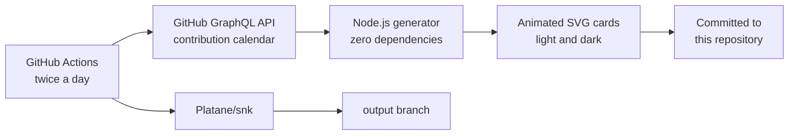

  

  <picture>
    <source media="(prefers-color-scheme: dark)" srcset="https://readme-typing-svg.demolab.com?font=JetBrains+Mono&weight=600&size=22&duration=2800&pause=900&color=6DA7EC&center=true&vCenter=true&width=760&height=48&lines=Software+%26+AI+Engineer;I+build+LLM+agents+with+Claude%2C+Gemini+%26+OpenAI;Full-stack%3A+Next.js+%C2%B7+NestJS+%C2%B7+TypeScript;Automating+real+work+with+n8n+%2B+AI;From+prototype+to+production" />
    
  </picture>

  
  
  
  
  

  

## 👋 About me

I build **AI-powered products end to end**: the LLM agents and document pipelines at the core, and the full-stack SaaS around them.
Most of my work lives in private client repositories, so every number on this page comes straight from my contribution calendar, **private work included**.

- 🔭 **Right now:** shipping AI features into production SaaS products
- 🌱 **Exploring:** agentic workflows and local LLMs with Ollama
- 💬 **Ask me about:** LLM integrations, Next.js, NestJS, automation with n8n
- ⚡ **Fun fact:** most of my 5,000+ contributions happened in private repos, so the graph below is the real picture

## 🧠 What I build

<table>
  <tr>
    <td width="50%" valign="top">
      <h3>🤖 AI agents &amp; automation</h3>
      LLM assistants and workflows on <b>Claude</b>, <b>Gemini</b> and <b>OpenAI</b>: tool calling, prompt pipelines and <b>n8n</b> automations wired into real business systems.
        
      <code>Anthropic SDK</code> <code>Google GenAI</code> <code>OpenAI</code> <code>LangChain</code> <code>n8n</code>
    </td>
    <td width="50%" valign="top">
      <h3>📄 Document intelligence</h3>
      Résumé and document pipelines: PDF and DOCX parsing, OCR with Tesseract and Cloud Vision, structured extraction with <b>Vertex AI</b> and LLMs, PDF generation with Puppeteer.
        
      <code>Vertex AI</code> <code>Cloud Vision</code> <code>Tesseract.js</code> <code>pdf-parse</code> <code>Puppeteer</code>
    </td>
  </tr>
  <tr>
    <td width="50%" valign="top">
      <h3>🎯 AI career &amp; hiring tools</h3>
      CV builders and AI interview experiences powered by <b>Claude</b> and <b>Gemini</b>, built on Next.js with MongoDB and S3 storage.
        
      <code>Next.js</code> <code>Claude</code> <code>Gemini</code> <code>MongoDB</code> <code>AWS S3</code>
    </td>
    <td width="50%" valign="top">
      <h3>🖼️ ML microservices</h3>
      Background-removal services in Python: <b>PyTorch</b> with Hugging Face Transformers and rembg behind FastAPI or Flask, shipped as Docker containers.
        
      <code>PyTorch</code> <code>Transformers</code> <code>rembg</code> <code>FastAPI</code> <code>Docker</code>
    </td>
  </tr>
  <tr>
    <td width="50%" valign="top">
      <h3>🌐 Full-stack SaaS</h3>
      Next.js and React frontends, <b>NestJS</b> and Express APIs, Prisma with PostgreSQL or MongoDB, Redis and BullMQ queues, <b>Stripe</b> subscriptions and multi-language UIs.
        
      <code>Next.js</code> <code>NestJS</code> <code>Prisma</code> <code>PostgreSQL</code> <code>Stripe</code>
    </td>
    <td width="50%" valign="top">
      <h3>📱 Mobile &amp; real-time</h3>
      <b>React Native</b> and Expo apps and installable PWAs, with Firebase, Socket.io real-time features and Twilio messaging.
        
      <code>React Native</code> <code>Expo</code> <code>Firebase</code> <code>Socket.io</code> <code>Twilio</code>
    </td>
  </tr>
</table>

## 🛠️ Tech stack

<table>
  <tr>
    <td align="right" width="150"><b>Languages</b></td>
    <td>
      <picture>
        <source media="(prefers-color-scheme: light)" srcset="https://skillicons.dev/icons?i=ts%2Cjs%2Cpy%2Chtml%2Ccss%2Cbash&theme=light" />
        
      </picture>
    </td>
  </tr>
  <tr>
    <td align="right"><b>AI &amp; ML</b></td>
    <td>
      
      
      
      
      
      
      
      
      
    </td>
  </tr>
  <tr>
    <td align="right"><b>Frontend</b></td>
    <td>
      <picture>
        <source media="(prefers-color-scheme: light)" srcset="https://skillicons.dev/icons?i=react%2Cnextjs%2Credux%2Ctailwind%2Cvite%2Cmaterialui%2Csass%2Cthreejs%2Cvue&theme=light" />
        
      </picture>
    </td>
  </tr>
  <tr>
    <td align="right"><b>Backend</b></td>
    <td>
      <picture>
        <source media="(prefers-color-scheme: light)" srcset="https://skillicons.dev/icons?i=nodejs%2Cexpress%2Cnestjs%2Cfastapi%2Cflask%2Cprisma&theme=light" />
        
      </picture>
    </td>
  </tr>
  <tr>
    <td align="right"><b>Data</b></td>
    <td>
      <picture>
        <source media="(prefers-color-scheme: light)" srcset="https://skillicons.dev/icons?i=postgres%2Cmongodb%2Credis%2Cfirebase&theme=light" />
        
      </picture>
    </td>
  </tr>
  <tr>
    <td align="right"><b>Cloud &amp; DevOps</b></td>
    <td>
      <picture>
        <source media="(prefers-color-scheme: light)" srcset="https://skillicons.dev/icons?i=docker%2Caws%2Cgcp%2Cvercel%2Cnetlify%2Cgithubactions%2Clinux&theme=light" />
        
      </picture>
    </td>
  </tr>
  <tr>
    <td align="right"><b>Testing &amp; tools</b></td>
    <td>
      <picture>
        <source media="(prefers-color-scheme: light)" srcset="https://skillicons.dev/icons?i=jest%2Cvitest%2Cgit%2Cgithub%2Cvscode&theme=light" />
        
      </picture>
    </td>
  </tr>
</table>

<b>🧰 More tools I use in production</b>

 

  
  
  
  
  
  
  
  
  
  
  
  

## 📊 GitHub activity

<picture>
  <source media="(prefers-color-scheme: dark)" srcset="https://raw.githubusercontent.com/omerfarooqBM/omerfarooqBM/main/assets/stats-dark.svg" />
  
</picture>

<picture>
  <source media="(prefers-color-scheme: dark)" srcset="https://raw.githubusercontent.com/omerfarooqBM/omerfarooqBM/main/assets/city-dark.svg" />
  
</picture>

<picture>
  <source media="(prefers-color-scheme: dark)" srcset="https://raw.githubusercontent.com/omerfarooqBM/omerfarooqBM/output/snake-dark.svg" />
  
</picture>

<b>📋 The numbers behind the charts</b>

<!-- stats:start -->

**Contributions per year**

| 2021 | 2022 | 2023 | 2024 | 2025 | 2026 |
|:---:|:---:|:---:|:---:|:---:|:---:|
| 374 | 126 | 49 | 1,381 | 1,021 | 2,128 |

**Last 12 months**

| Dec ’25 | Jan ’26 | Feb ’26 | Mar ’26 | Apr ’26 | May ’26 | Jun ’26 | Jul ’26 | Aug ’26 | Sep ’26 | Oct ’26 | Nov ’26 |
|:---:|:---:|:---:|:---:|:---:|:---:|:---:|:---:|:---:|:---:|:---:|:---:|
| 88 | 197 | 238 | 201 | 203 | 116 | 214 | 357 | 217 | 191 | 128 | 66 |

- **All-time:** 5,080 contributions since May 2019
- **Last 12 months:** 2,227 contributions across 274 active days
- **Streaks:** 52 days longest (25 Mar – 15 May 2026)
- **Best day:** 62 contributions on 27 Jan 2026 · most active on Tuesdays

Refreshed automatically · last update 27 Nov 2026

<!-- stats:end -->

<b>📈 More live cards</b>

 

  <picture>
    <source media="(prefers-color-scheme: dark)" srcset="https://streak-stats.demolab.com?user=omerfarooqBM&hide_border=true&background=0D1117&ring=3987E5&fire=3987E5&currStreakNum=F0EFEC&sideNums=F0EFEC&currStreakLabel=6DA7EC&sideLabels=C3C2B7&dates=898781&stroke=30363D" />
    
  </picture>
  <picture>
    <source media="(prefers-color-scheme: dark)" srcset="https://github-readme-activity-graph.vercel.app/graph?username=omerfarooqBM&bg_color=0d1117&color=c3c2b7&title_color=f0efec&line=3987e5&point=f0efec&area=true&area_color=3987e5&hide_border=true&radius=8&custom_title=Last%2031%20days" />
    
  </picture>

<b>⚙️ How this profile updates itself</b>

The terminal, activity and city cards are drawn by [`scripts/generate.mjs`](https://github.com/omerfarooqBM/omerfarooqBM/blob/main/scripts/generate.mjs) from live GitHub data, so there is no third-party stats server to rate-limit or go down. Edit [`profile.config.json`](https://github.com/omerfarooqBM/omerfarooqBM/blob/main/profile.config.json) to change the terminal text.

## 🤝 Connect

  
  
  
  

  

